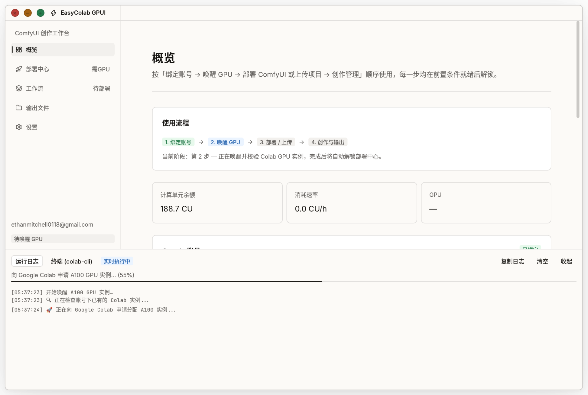

# EasyColab GPUI

面向 Google Colab 的桌面工作台，支持 Windows x64 和 Linux x64。在一个窗口中管理 GPU 实例、部署 ComfyUI、上传自己的项目，并查看运行状态与生成结果。



## 功能

| 功能 | 说明 |
| --- | --- |
| 账号与 GPU | 浏览器登录 Google 账号，查看计算单元（CU）余额与消耗速率，唤醒、接管、切换和释放 Colab GPU 实例。 |
| ComfyUI 部署 | 在已就绪的 GPU 上部署 ComfyUI，支持启动、停止、重启、释放显存和打开浏览器节点画布。 |
| 自定义项目 | 上传本地文件或项目目录到实例临时磁盘或已挂载的 Google Drive，通过底部终端安装依赖、运行脚本。 |
| 工作流与模型 | 按需安装 Wan2.2 14B、MiniMax-H3 Turbo、LTX-2.3 22B、HunyuanVideo 1.5 预设包，也可自行填写模型下载地址或 Hugging Face 来源。 |
| 输出管理 | 刷新云端输出、下载到本地、在应用内预览图片，使用系统播放器打开视频，浏览已下载文件。 |
| 监控与设置 | 查看显存、内存、磁盘和任务状态，复制运行日志、使用 colab-cli 终端、同步 Drive；支持中英文、主题切换和自定义保存目录。 |

## 下载与启动

前往 [GitHub Releases](https://github.com/Qingyun0118/easycolab-gpui/releases/latest)，下载对应系统的压缩包并完整解压到可写目录。请保留压缩包中的 `python/`、`scripts/` 和启动脚本。

### Windows x64

需要 Windows 10/11 x64、支持 DirectX 11 的显卡驱动和 [Python 3.12 x64](https://www.python.org/downloads/windows/)。使用 SSH 本机直连或云端交互终端时，还需在系统「可选功能」中安装 OpenSSH 客户端。

在解压目录打开 PowerShell，运行：

```powershell
powershell -ExecutionPolicy Bypass -File .\run.ps1
```

### Linux x64

需要 glibc 2.35 或更新版本、Python 3.12 或更新版本及 venv，以及 fontconfig、xkbcommon-x11、Wayland/X11、OpenSSL 运行库。SSH 功能需要 OpenSSH 客户端。

在解压目录运行：

```bash
./run.sh
```

首次启动会自动创建 Python 环境并安装依赖，需要联网。只想体验界面时，在启动命令末尾加上 `--mock`；演示模式不需要 Python，也不会连接真实 Google 账号或创建 GPU 实例。

## 如何使用

### 1. 绑定账号

在「概览」点击「在浏览器中登录」，完成 Google 授权后会自动回到客户端。若无法回跳，选择「使用授权码登录」，将授权码填回客户端完成登录。

### 2. 唤醒 GPU

选择需要的 GPU，点击「唤醒 GPU 实例」，确认后等待分配和连通性校验。若检测到已有实例，可点击「验证并接管 GPU 实例」。实例就绪后，「部署中心」会解锁，可实时查看显存、内存和磁盘使用情况。

唤醒 GPU 后，选择下面任一种方式继续使用。

### 3. 部署 ComfyUI 并创作

1. 进入「部署中心」，设置管理密码（留空可自动生成），点击「部署 ComfyUI」，等待部署与连接完成。
2. 进入「工作流」，安装需要的预设工作流包和模型权重，或填写地址下载自定义权重。
3. 打开浏览器节点画布，选择工作流、上传素材并运行。公网画布的登录用户名为 `easycolab`，密码为管理密码；也可开启 SSH 本机直连。
4. 在「输出文件」刷新结果并下载。图片可在应用内预览，视频通过系统播放器打开；保存位置可在「设置」中修改。

### 或：上传并运行自己的项目

1. 在「部署中心」的「上传本地项目到云端」中选择文件或项目目录，设置云端目标目录。
2. 选择实例临时磁盘，或已挂载的 Google Drive，开始上传。
3. 打开底部「终端 (colab-cli)」，输入 `colab ssh -s` 进入云端实例，再切换到上传目录、安装依赖并运行项目。此流程无需部署 ComfyUI。

### 连接已有服务

如果已经部署了 EasyColab 服务，可在「设置」填写 HTTPS 服务地址和管理密码并保存，再到「概览」的「连接已有服务」点击「连接」，直接使用工作流和输出管理。

### 结束使用

使用 ComfyUI 时，先在「工作流」点击「同步到 Drive」，确认需要的输出已保存，再释放实例。自定义项目请先将需要保留的数据保存到 Drive 或下载到本地。

停止 ComfyUI 或关闭客户端不会释放 GPU，实例仍可能消耗计算单元。「释放账号下全部实例」会结束该 Google 账号下的所有活跃实例，请确认后操作。

## 参考仓库

- [EasyColab](https://github.com/wy51ai/easycolab)
- [Colab Playground](https://github.com/scarletkc/colab-playground)
- [GPUI](https://github.com/zed-industries/zed/tree/main/crates/gpui)
- [Ely GPUI Components](https://github.com/ELY-Open-Source/Ely-GPUI-Components)
