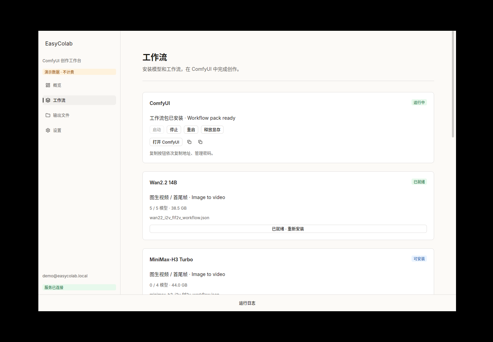

# EasyColab GPUI

使用 Rust、GPUI 和 Ely GPUI Components 构建的 EasyColab ComfyUI 桌面客户端。
支持 Windows x64 与 Linux x64：管理 Colab、ComfyUI、预置工作流、权重、Drive 和生成结果。
节点画布由浏览器打开，图片在应用内预览，视频使用系统播放器。



[查看原生图片预览截图](assets/mock-preview.png)

## 下载与运行

从 [GitHub Releases](https://github.com/Qingyun0118/easycolab-gpui/releases/latest) 下载系统对应的压缩包，完整解压后运行。每个包附有 `.sha256` 校验文件；不要只复制可执行文件，`python/` 和 `scripts/` 需要与其一起保留。

### Windows x64

要求 Windows 10/11 x64，支持 DirectX 11 的显卡驱动。演示模式不需要 Python；使用 Google/Colab 桥接时安装 [Python 3.12 x64](https://www.python.org/downloads/windows/)。本地 SSH 转发还需要 Windows 的 OpenSSH 客户端（在系统「可选功能」中安装）。

在解压目录打开 PowerShell：

```powershell
powershell -ExecutionPolicy Bypass -File .\run.ps1 --mock
# 使用真实服务，首次运行会创建 .venv 并安装桥接依赖
powershell -ExecutionPolicy Bypass -File .\run.ps1
```

也可直接运行 `easycolab-gpui.exe --mock`；真实服务首次使用前先运行 `scripts\setup-python.ps1`。若 Python 不在默认位置，设置 `$env:EASYCOLAB_PYTHON = 'C:\path\to\python.exe'`。解压到当前用户有写入权限的目录；移动或复制安装目录后，删除旧 `.venv` 并重新运行设置脚本。

### Linux x64

发布包在 Ubuntu 22.04 构建，需要 glibc 2.35 或更新版本，以及 fontconfig、xkbcommon-x11、Wayland/X11、OpenSSL 等系统运行库。真实服务需要 Python 3.12 或更新版本及 venv；SSH 转发需要 OpenSSH 客户端。

```bash
./run.sh --mock
./run.sh
```

首次使用真实服务时，启动脚本会准备项目自己的 Python 虚拟环境。

## 从源码构建

### Linux

```bash
./scripts/setup.sh
./run.sh --mock
```

`--mock` 使用内存中的演示后端，提供账号、资源、工作流安装和输出下载演示，不使用真实 Google 账号，不创建付费实例，也不安装 Python 桥接依赖。演示设置保存在配置目录的 `demo/` 中，默认输出也使用独立的 `Demo/` 子目录。

使用真实服务：

```bash
./run.sh
```

启动脚本会准备项目自己的 Python 虚拟环境。首次 Rust 构建需要下载依赖。
也可以先执行 `./scripts/setup-python.sh`，然后在 `source scripts/env.sh` 后运行 `cargo run -- --mock` 或 `cargo run`。

工具链和本地开发库存放在 `.tooling/`，Python 环境为 `.venv/`，构建输出为 `target/`。
这些目录均不属于项目源代码，清理后可通过脚本重新创建。

### Windows

安装 [Rust](https://rustup.rs/)（MSVC 工具链）、[Visual Studio 2022 Build Tools](https://visualstudio.microsoft.com/downloads/) 的「使用 C++ 的桌面开发」和 Windows SDK，以及 Python 3.12 x64。Windows SDK 中的 `fxc.exe` 用于编译 GPUI 的发行版着色器。

```powershell
powershell -ExecutionPolicy Bypass -File .\scripts\setup.ps1
powershell -ExecutionPolicy Bypass -File .\run.ps1 --mock
# 原生 Windows x64 发行构建
cargo +1.98.0 build --release --locked --target x86_64-pc-windows-msvc
python scripts/package.py --binary target/x86_64-pc-windows-msvc/release/easycolab-gpui.exe --target x86_64-pc-windows-msvc --version v0.1.0-local
```

## 使用流程

1. 在工作台绑定 Google 账号：打开授权网页，将授权码填回客户端。
2. 选择 GPU 并唤醒部署。已有实例会被原桥接程序复用或调整；切换 GPU 前阅读确认信息。
3. 也可填写已经部署的 EasyColab HTTPS 服务地址和管理密码，直接连接。
4. 启动 ComfyUI，在「工作流与模型」安装需要的预置包，或下载自定义权重。
5. 打开浏览器节点画布，登录用户名为 `easycolab`，密码与管理密码相同。在画布里选择工作流、上传素材并运行。
6. 在「输出」中刷新云端结果，手动下载。图片可在应用内查看，视频和本地目录由系统程序打开。
7. 结束使用时同步 Drive，并释放实例。

四套预置包沿用服务端定义：Wan2.2、MiniMax-H3 Turbo、LTX-2.3、HunyuanVideo 1.5。权重只在选择安装或下载时获取。

停止 ComfyUI 只停止服务，Colab 实例仍可能计费。登录桥接的「释放全部实例」作用于该 Google 账号下所有活跃实例，操作前需要确认；手动连接服务时只能通过服务接口释放当前实例。

## 配置与云端数据

- 设置：Linux 为 `~/.config/easycolab-gpui/settings.json`，Windows 为 `%APPDATA%\easycolab-gpui\settings.json`，可用 `EASYCOLAB_GPUI_CONFIG_DIR` 覆盖配置目录；Linux 目录权限 `0700`，配置文件权限 `0600`，Windows 使用用户配置目录的继承权限。服务管理密码和 HF token 会保存在该文件中，界面与日志脱敏；不要把该文件加入 Git 或分享。
- 本地输出：默认用户视频目录下的 `EasyColab-GPUI`，可在设置中修改。
- Google 登录：复用 EasyColab 桥接与 Colab CLI 的 OAuth/keyring 存储。因此它与本机已有 Colab CLI 共享登录状态。
- Google Drive：沿用 EasyColab 的目录和挂载/rclone/仅本地三种持久化模式，界面显示实际状态。
- 闲置策略：沿用原服务语义。ComfyUI 处于运行状态时被视为活跃，不能把「队列为空」理解为将自动释放。

本期复用完整 EasyColab 云端服务，部署仍会安装部分非 ComfyUI 引擎使用的 Python 依赖，但客户端不提供其他引擎的功能页面。

## 结构与接口

- `src/`：原生界面、应用状态、配置、Python 桥接和 HTTP 客户端。
- `python/`：独立快照，不引用相邻 EasyColab 目录。
- `tests/`：假服务、假桥接、GPUI 无窗口交互和原 Python 功能的回归测试。

管理请求使用 Basic Auth（用户名 `easycolab`）。客户端复用以下接口，不修改云端 HTTP 协议：

| 接口 | 用途 |
| --- | --- |
| `GET /minimax_api/status` | 资源、日志、队列、工作流、输出状态 |
| `POST /minimax_api/comfyui/start` | 启动或重启 |
| `POST /minimax_api/comfyui/stop` | 同步后停止 ComfyUI |
| `POST /minimax_api/comfyui/free_vram` | 清理缓存显存 |
| `POST /minimax_api/comfyui/sync_drive` | Drive 同步 |
| `POST /minimax_api/comfyui/download_weight` | 下载权重 |
| `POST /minimax_api/comfyui/install_pack` | 安装预置包 |
| `GET /minimax_api/comfyui/output_media/{path}` | 下载输出 |
| `POST /minimax_api/config_idle` | 设置闲置时间 |
| `POST /minimax_api/disconnect` | 释放手动连接的实例 |

## 自动验证

```bash
source scripts/env.sh
cargo fmt --all -- --check
cargo clippy --all-targets --locked -- -D warnings
cargo test --locked
cargo build --locked
PYTHONPATH=python .venv/bin/python -m unittest discover -s tests -p 'test_*.py'
```

Rust 测试使用内存演示后端、本地假 HTTP 服务和假 Python 脚本；Python 回归测试使用 mock 或 AST 提取辅助函数，不启动云端推理服务。
自动测试不运行真实 Colab 操作。

Windows 的等效验证：

```powershell
cargo +1.98.0 fmt --all -- --check
cargo +1.98.0 clippy --all-targets --locked -- -D warnings
cargo +1.98.0 test --locked
$env:PYTHONPATH = 'python'
& .\.venv\Scripts\python.exe -m unittest discover -s tests -p 'test_*.py'
```

## 自动 Release

`.github/workflows/release.yml` 在每次 PR 上验证 Windows 和 Linux；每次提交或合并到 `main` 后，先完成两种系统的格式、静态检查、Rust/Python 测试及原生发行构建，再自动发布一个包含 Windows ZIP、Linux tar.gz 和 SHA-256 校验文件的 GitHub Release。版本格式为 `v<Cargo版本>-main.<运行编号>.<重试编号>.<提交短SHA>`；成功上传后更新 Latest，构建失败不会替换现有 Release。也可在 Actions 中针对 `main` 手动触发。

构建任务只有仓库读取权限；发布任务单独使用 GitHub 自动提供的 `GITHUB_TOKEN` 的 `contents: write` 权限，不需要创建或保存个人令牌。若仓库或组织策略禁止 Actions 发布，需在 GitHub 设置中允许此工作流的写入权限。

## 真实环境验收

在准备使用付费 GPU 时手工验证：Google 授权与 CU → 唤醒部署 → 连接管理服务 → 启动 ComfyUI → 安装所选工作流包 → 浏览器运行一条工作流 → 下载图片/视频 → Drive 同步 → 释放实例，并在 Colab 网页确认计费已经结束。
网络或授权失败时保留日志，重新连接读取实际状态；操作超时不代表云端任务已经结束。

## 来源与许可

Python 服务与桥接基于 [EasyColab](https://github.com/wy51ai/easycolab)，包含其 OAuth/keyring 兼容修改；界面骨架参考 [Colab Playground](https://github.com/scarletkc/colab-playground)。
详见 `NOTICE`、`LICENSE` 和 `licenses/`。GPUI/Ely 使用各自的依赖许可证。
